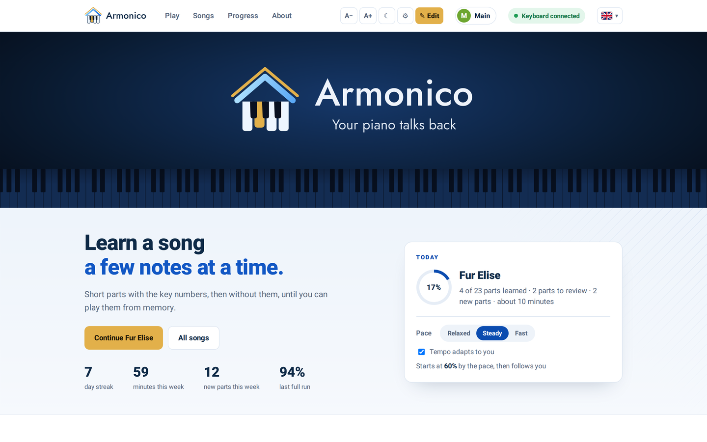
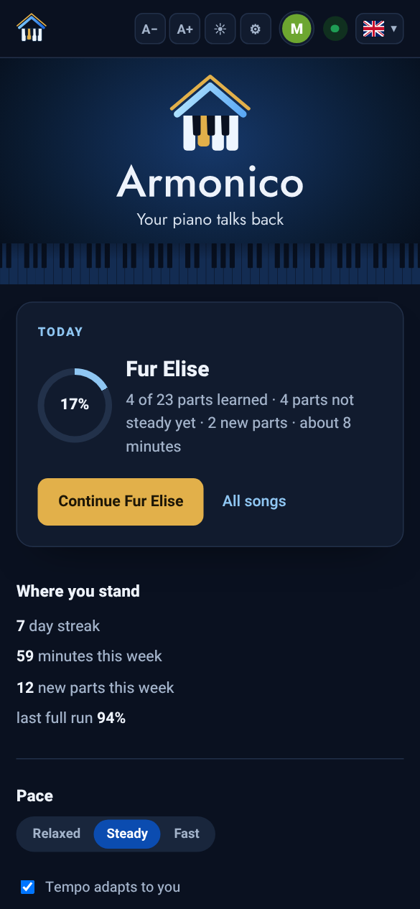

<p align="center">
  <picture>
    <source media="(prefers-color-scheme: dark)" srcset="docs/images/logo-dark.svg">
    
  </picture>
</p>

# Armonico

**Your piano talks back.**

Armonico connects a USB MIDI keyboard to a smart home. A short melody played on the keys runs a Home Assistant automation, and the house plays songs on the real keyboard: an alarm every morning that keeps playing until the lowest key is pressed, or a tune when something happens. Lessons teach a song a few short parts at a time, first with key numbers on a screen and then from memory, with the song's own band playing along.

It runs on a small Linux machine next to the keyboard (a Raspberry Pi, a mini PC or a virtual machine) and talks over MQTT. An Android app does the same on a phone, and is still in testing ([android/README.md](android/README.md)).

<p align="center">
  
</p>

<p align="center">
  
</p>

## What it does

**Shortcuts.** A melody of a few notes triggers an automation. New shortcuts are taught by playing them, from Telegram or the terminal.

**Playback and the alarm clock.** Any MIDI file plays on the keyboard, started from Telegram, an automation, the terminal or plain MQTT. The alarm repeats its song until the lowest key is pressed.

**Lessons.** A song's melody, taught in short parts. The help is removed in three steps. Each lesson adds 1 to 4 new parts: the pace you chose, one fewer when parts start to fade, one more when everything holds, with no daily limit. Every part comes back until it sticks, and a full run is scored, with the band when the file has one. [How the method works](docs/learning-method.md).

**The lesson screen.** A live keyboard in any browser on the home network: the next key, the finger, the progress. In English or Hebrew, and playable with the computer's own keys.

**Profiles.** Several people on one keyboard, each with their own progress, recordings, pace and language, and an optional PIN.

**A watchdog.** It notices when the keyboard disconnects or goes silent, reports why, and brings it back on its own.

**Telegram and the terminal.** Status, playback, shortcuts, lessons, song downloads and a live log, from a Telegram bot or the `armonico` command on the machine.

**Any keyboard.** 25 to 88 keys. The setup measures it from its two end keys.

## How it works

```
 USB MIDI keyboard
        │  keys, pedal                      ▲  songs, alarm, lesson demos
        ▼                                   │
┌─────────────────────────── Linux machine ──────────────────────────┐
│  bridge      shortcuts · playback · alarm · watchdog               │
│  lessons     lesson engine · lesson screen on port 8099            │
└──────────────────────────────┬─────────────────────────────────────┘
                               │ MQTT  (piano/…)
                               ▼
                      MQTT broker  ◄──►  Home Assistant  ◄──►  Telegram
```

## Quick start

On Debian, Ubuntu or Raspberry Pi OS, with the keyboard plugged in:

```bash
git clone https://github.com/vestacorelabs/armonico.git
cd armonico
sudo ./install.sh
```

With Home Assistant OS or Supervised, the installer can set Home Assistant up as well, from one access token (Home Assistant profile, Security, Long-lived access tokens): the MQTT broker, the sensors, the automations and the blueprints. It asks for the token during the install, and says how to make it. Details in [docs/home-assistant.md](docs/home-assistant.md).

While it installs, the keyboard can play a little classical music, which also shows that the USB connection works both ways. The installer then asks about the MQTT broker: an existing one, such as the Mosquitto broker app in Home Assistant, or a new one on this machine. Home Assistant is optional ([what works without it](docs/installation.md#without-home-assistant)). Last, a one-time setup screen opens in the browser for the broker and the keyboard.

A first test, once the install is done (without `sudo` after the next login, see [the armonico command](docs/commands.md#the-armonico-command)):

```bash
sudo armonico play ode_to_joy
```

## Documentation

| Guide | Contents |
|---|---|
| [Installation](docs/installation.md) | Requirements, supported machines, setup, files, updates, removal, troubleshooting |
| [Hardware](docs/hardware.md) | Keyboards, 5-pin MIDI, a Raspberry Pi as a USB MIDI gadget, the Armonico Pi device, long cables, the equipment it was tested on |
| [After a power loss, and the deep check](docs/power-loss-and-deep-check.md) | The Armonico Pi's recovery screen after a power loss, and the deep check of the services and the system |
| [Questions and pitfalls](docs/faq.md) | Common questions, and the mistakes that break a setup |
| [Sorry for asking](docs/sorry-for-asking.md) | The honest answers: is it a real piano, was it built with AI, who is responsible, why the keys click |
| [Song archives](docs/sources.md) | Where the song search looks, and the license of each archive |
| [Settings](docs/configuration.md) | Every setting and where it lives: the settings file, the lesson screen, the browser, Home Assistant, Telegram, the broker |
| [Terminal commands](docs/commands.md) | The `armonico` command, the installer, full removal, services, MQTT recording, tools |
| [MQTT](docs/mqtt.md) | Setting up a broker, and every topic |
| [Home Assistant](docs/home-assistant.md) | The package, and the alarm, shortcut and reminder blueprints |
| [Telegram](docs/telegram.md) | Creating the bot, and every command |
| [The learning method](docs/learning-method.md) | How lessons work, and why |
| [The status screen](docs/screen.md) | The touch status page at `/status`: what it shows, its broker connection, a display on the Pi itself |
| [Android](android/README.md) | The app: the bridge, the lessons and the alarm on a phone, its two broker modes, building it |

## Tests

A lesson only runs with a keyboard plugged in, so the tests cover what the playing rests on rather than the playing itself: cutting a song into parts, reading a run, when a part counts as steady, the key numbers, the hand plan, the lesson screen's access checks, and whether every line the player reads has a Hebrew version. They need no keyboard and no internet. The lesson screen's server is started on this machine only, in a temporary folder. The whole run takes about five minutes.

```bash
pip install -r requirements.txt
pip install pygame fonttools brotli python-bidi astronomy-engine pyluach zxing-cpp numpy
sudo apt install mosquitto mosquitto-clients     # for the bridge tests
sudo -E python3 -m unittest discover -s tests     # as root: the installer's tests give files to root
```

The second line is what the Armonico Pi screen's tests need, and the third what the bridge's tests need. Without them, those tests are skipped or fail with a line naming what is missing.

## About

Armonico is built and maintained in the Vesta Core Labs home lab with the help of AI. It has been in daily use there for more than six months, on a real keyboard with a real alarm every morning.

Vesta Core Labs is a home lab, not a registered business. The code is written together with Claude and tested on real hardware. The characters and the sky on the Armonico Pi screen are decoration, separate from the learning.

Bugs and questions are welcome in [Issues](https://github.com/vestacorelabs/armonico/issues). The most useful report includes the output of `armonico logs` (or `journalctl -u armonico-bridge -n 100`) and what the keyboard was doing at the time.

## Security

Security problems go to the private channel described in [SECURITY.md](SECURITY.md), not to a public issue. That file also says what the project does and does not defend, which is worth reading before putting it on a network that is not only yours.

## License

[MIT](LICENSE). The software is provided as is, without warranty of any kind.

It ships with work by other people, under their own licenses, and those licenses travel with any copy of this repository. [NOTICE](NOTICE) lists all of it: the Salamander Grand Piano recordings by Alexander Holm under CC BY 3.0, the Heebo font under the SIL Open Font License, and the public domain editions from the [Mutopia Project](https://www.mutopiaproject.org/) the installer's music is cut from, listed piece by piece in [setup/music/SOURCES.md](setup/music/SOURCES.md).

Songs downloaded by the song search are not part of this repository. Each one's license is recorded next to the file when it is saved, and some carry a share-alike condition. [docs/sources.md](docs/sources.md) says which archives are reached and why.
